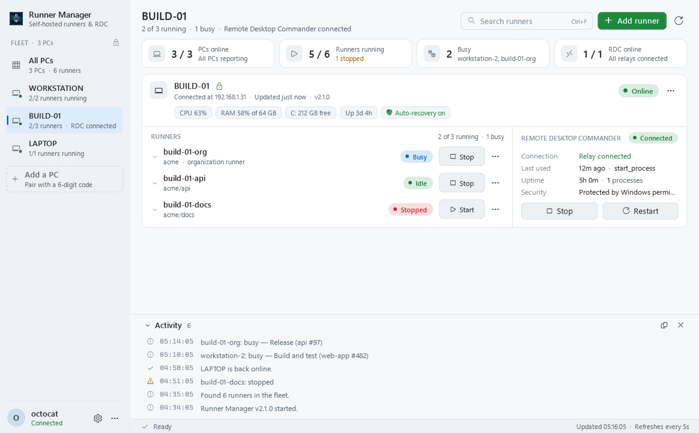

<div align="center">


# Runner Manager

A Windows dashboard for GitHub Actions self-hosted runners, on one PC or several.

[](https://github.com/Sandiozo/runner-widget/actions/workflows/ci.yml)


[](LICENSE)

</div>


## Features

- **Runners.** Add repository or organization runners, then start, stop, restart, edit, move and remove them. Runner
  Manager downloads the official runner, verifies its SHA-256 checksum and installs it as a Windows service.
- **Status at a glance.** Each runner shows its state, current job, recent workflow runs, version and work folder size.
  Each PC shows CPU, memory, disk space, uptime and pending restarts.
- **Several PCs.** PCs connect directly over the local network, encrypted. Control the runners on every PC from any
  of them. A single PC works without any fleet setup.
- **Auto-recovery.** The fleet agent restarts runners that stop unexpectedly.
- **Notifications.** Alerts in the notification area when a PC goes offline, a runner stops or a workflow run fails.
- **Remote Desktop Commander (optional).** Monitor and restart it on each PC. It is shown only where it is set up.
- **Updates.** Installs new releases on every PC from the dashboard.

<table>
  <tr>
    <td width="60%"></td>
    <td width="40%"></td>
  </tr>
  <tr>
    <td align="center">PC view, light theme</td>
    <td align="center">Setup wizard</td>
  </tr>
</table>

## Install

1. Install the [.NET 8 Desktop Runtime](https://dotnet.microsoft.com/download/dotnet/8.0).
2. Download **RunnerManagerSetup.exe** from [Releases](https://github.com/Sandiozo/runner-widget/releases) and run it.
3. Choose **This PC only** or **Several PCs**, and whether you use Remote Desktop Commander.

Runner Manager installs for the current user to `%LOCALAPPDATA%\Programs\RunnerManager`. To uninstall, use
**Settings → Apps** in Windows, or **Settings → Updates → Uninstall…** in Runner Manager. Your runners keep running.

To add, repair or remove runners, sign in with the [GitHub CLI](https://cli.github.com): click **Connect GitHub** in
the account menu. Runner Manager does not store GitHub credentials.

## Several PCs

To add a PC to the fleet:

1. On a PC in the fleet, click **Add a PC** in the sidebar.
2. On the new PC, click **Connect another PC → Join an existing fleet**, and select the PC it finds.
3. Check that both PCs show the same 6-digit code, then click **Allow**.

| | |
| --- | --- |
| Transport | Direct PC-to-PC connections. Fleet traffic does not go through GitHub. |
| Encryption | AES-256-GCM. The key is derived from the pairing code and bound to the target PC and a timestamp. Replayed requests are rejected. |
| Pairing | ECDH P-256 key exchange, confirmed with a 6-digit code on both PCs. |
| Storage | The pairing code is encrypted for your Windows account (DPAPI). |
| Ports | TCP 47821 and UDP 47822. TCP 47823 and UDP 47824 during pairing only. Firewall rules allow the local subnet and Tailscale (`100.64.0.0/10`). |
| Other networks | Install [Tailscale](https://tailscale.com) on both PCs, then use **Settings → Fleet → Add a PC by address**. |

Auto-recovery restarts a runner or Remote Desktop Commander that stops unexpectedly, up to three times an hour. It does
not restart anything you stop from Runner Manager. Turn it on or off for each PC in the PC's ⋯ menu.

## Build from source

Requires Windows and the .NET 8 SDK.

```powershell
dotnet build -c Release
dotnet test
```

To build the installer:

```powershell
dotnet publish src/RunnerWidget -c Release -r win-x64 -p:SelfContained=false -p:PublishSingleFile=true -o publish
Copy-Item publish/RunnerWidget.exe publish/RunnerManagerSetup.exe
```

Any copy named `RunnerManagerSetup.exe`, or started with `--setup`, opens the setup wizard.

To publish a release, push a version tag. The **Release** workflow runs the tests, builds the exe and attaches it to
a GitHub release.

```powershell
git tag v2.1.0
git push origin v2.1.0
```

## Project layout

```text
src/RunnerWidget/          WPF app: dashboard, setup wizard and fleet agent
tests/RunnerWidget.Tests/  xUnit tests
docs/images/               README screenshots
```

The app requests administrator rights, because it installs and controls Windows services. Settings and logs are
stored in `%LOCALAPPDATA%\RunnerWidget`.

## Keyboard shortcuts

| Shortcut | Action |
| --- | --- |
| `F5` | Refresh |
| `Ctrl+F` | Search runners |
| `Ctrl+N` | Add a runner |
| `Ctrl+,` | Settings |
| `Ctrl+0…9` | All PCs or a specific PC |

## License

[MIT](LICENSE)
