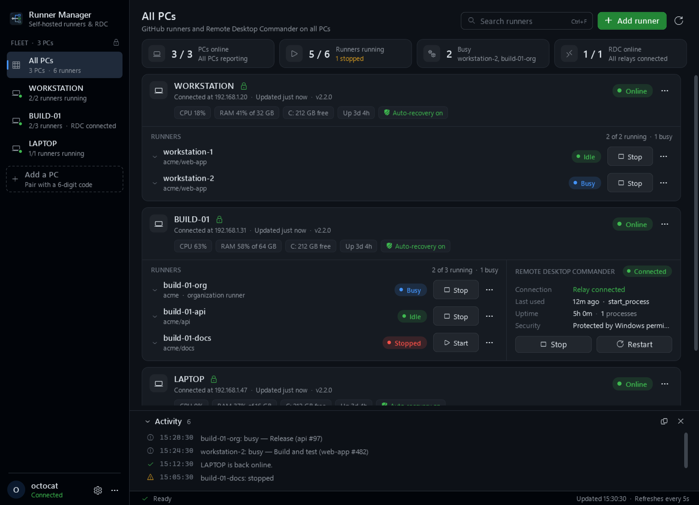
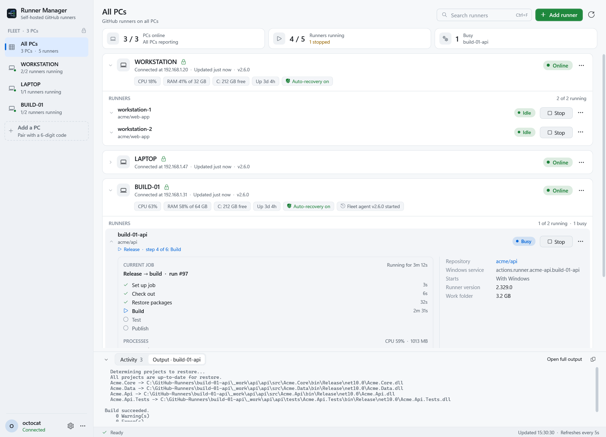
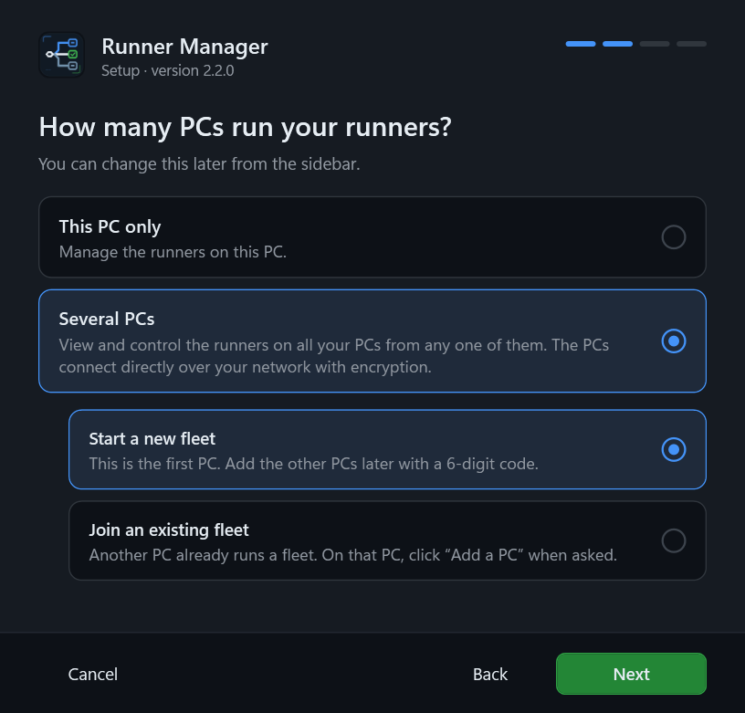

<div align="center">


A Windows dashboard for GitHub Actions self-hosted runners, on one PC or several.

[](https://github.com/Sandiozo/runner-manager/actions/workflows/ci.yml)


[](LICENSE)

</div>



## Features

- **Runners.** Add repository or organization runners, then start, stop, restart, edit, move and remove them. Runner
  Manager downloads the official runner, verifies its SHA-256 checksum and installs it as a Windows service, in a
  runner folder you choose for each PC.
- **Live jobs.** A busy runner shows its job and every step with its state and duration, the latest output of the
  running step, and the processes the job runs with their CPU and memory. This works for runners on every PC; steps
  are shown for repository runners.
- **Status at a glance.** Each runner shows its state, recent workflow runs, version and work folder size. Each PC
  shows CPU, memory, disk space, uptime and pending restarts.
- **Several PCs.** PCs connect directly over the local network, encrypted. Control the runners on every PC from any
  of them. A single PC works without any fleet setup.
- **AI assistants.** Claude, Codex, Copilot, Cursor, Gemini and other AI tools that support MCP can list your runners,
  check jobs and create a runner for a new project. Changes ask for your approval first.
- **Auto-recovery.** The fleet agent restarts runners that stop unexpectedly.
- **Notifications.** Alerts in the notification area when a PC goes offline, a runner stops or a workflow run fails.
- **Remote Desktop Commander (optional).** Monitor and restart it on each PC. It is shown only where it is set up, and
  needs [Node.js](https://nodejs.org).
- **Updates.** Installs new releases on every PC from the dashboard.

<table>
  <tr>
    <td width="60%"></td>
    <td width="40%"></td>
  </tr>
  <tr>
    <td align="center">Live job view, light theme</td>
    <td align="center">Setup wizard</td>
  </tr>
</table>

## Why Runner Manager

Self-hosted runners on Windows PCs are easy to start and hard to keep an overview of: each one is a folder, a Windows
service and a page on GitHub. Runner Manager puts them in one window, across all your PCs, without any server.

| | Runner Manager | GitHub runner settings | actions-runner-controller |
| --- | --- | --- | --- |
| Runs on | Your Windows PCs | Web page per repository or organization | A Kubernetes cluster |
| Installs and removes runners | Yes, as Windows services | Shows the commands to run | Yes, as containers |
| Live job steps, output and processes | Yes | Job logs on GitHub | Job logs on GitHub |
| PC health, auto-recovery, notifications | Yes | No | Through Kubernetes |
| Moves runners between PCs | Yes | No | Not applicable |
| Extra infrastructure | None | None | Cluster and controller |

If you run many short-lived Linux runners, a Kubernetes-based setup such as actions-runner-controller scales better.
Runner Manager is for the PCs you already have.

## Install

1. Download a setup from [Releases](https://github.com/Sandiozo/runner-manager/releases) and run it:
   - **RunnerManagerSetup-standalone.exe** includes .NET. Choose this one if you are not sure.
   - **RunnerManagerSetup.exe** is smaller and needs the [.NET 10 Desktop Runtime](https://dotnet.microsoft.com/download/dotnet/10.0).
2. Choose **This PC only** or **Several PCs**, and whether you use Remote Desktop Commander.

Windows may show "Windows protected your PC", because the setup is not code-signed. Click **More info → Run anyway**.
You can check the file against the SHA-256 checksum in the release notes.

Runner Manager installs for the current user, by default to `%LOCALAPPDATA%\Programs\RunnerManager`. To install it
somewhere else, click **Change…** on the first page of the setup; it gets its own `RunnerManager` folder there. To move
an existing install, run the setup again and choose another folder. To uninstall, use **Settings → Apps** in Windows,
or **Settings → Updates → Uninstall…** in Runner Manager. Your runners keep running.

Updates install a newer .NET Desktop Runtime automatically when a release needs one. Installs from version 2.1 or
earlier (called RunnerWidget) need the setup run once on each PC; it moves the settings and scheduled tasks over.

To add, repair or remove runners, sign in with the [GitHub CLI](https://cli.github.com): click **Connect GitHub** in
the account menu. Runner Manager does not store GitHub credentials.

## Several PCs

To add a PC to the fleet:

1. On a PC in the fleet, click **Add a PC** in the sidebar.
2. On the new PC, click **Connect another PC → Join an existing fleet**, and select the PC it finds.
3. Check that both PCs show the same 6-digit code, then click **Allow**.

| | |
| --- | --- |
| Transport | Direct PC-to-PC connections. Fleet traffic does not go through GitHub. |
| Encryption | AES-256-GCM. The key is derived from the pairing code and bound to the target PC and a timestamp. Replayed requests are rejected. |
| Pairing | ECDH P-256 key exchange, confirmed with a 6-digit code on both PCs. |
| Storage | The pairing code is encrypted for your Windows account (DPAPI). |
| Ports | TCP 47821 and UDP 47822. TCP 47823 and UDP 47824 during pairing only. Firewall rules allow the local subnet and Tailscale (`100.64.0.0/10`). |
| Other networks | Install [Tailscale](https://tailscale.com) on both PCs, then use **Settings → Fleet → Add a PC by address**. |

Auto-recovery restarts a runner or Remote Desktop Commander that stops unexpectedly, up to three times an hour. It does
not restart anything you stop from Runner Manager. Turn it on or off for each PC in the PC's ⋯ menu.

## Build from source

Requires Windows and the .NET 10 SDK.

```powershell
dotnet build -c Release
dotnet test
```

To build the installer:

```powershell
dotnet publish src/RunnerManager -c Release -r win-x64 -p:SelfContained=false -p:PublishSingleFile=true `
  -p:IncludeNativeLibrariesForSelfExtract=true -o publish
Copy-Item publish/RunnerManager.exe publish/RunnerManagerSetup.exe
```

Any copy named `RunnerManagerSetup.exe`, or started with `--setup`, opens the setup wizard.

To publish a release, push a version tag; the version comes from the tag. The **Release** workflow runs the tests,
builds the exe, checks that it starts, and attaches it to a GitHub release.

```powershell
git tag v2.2.6
git push origin v2.2.6
```

## AI assistants

Runner Manager is an [MCP](https://modelcontextprotocol.io) server, so any AI tool that supports MCP can use it. Tell
the assistant which repository a new project uses, and it can check whether the repository has a runner, create one
on the least busy PC, and tell you which `runs-on` labels to use.

1. Open **Settings → AI assistants** and turn on **Allow AI assistants**.
2. Choose your AI tool, click **Copy**, and paste the setup where the page says. For most tools it is:

   ```json
   {
     "mcpServers": {
       "runner-manager": {
         "command": "C:\\Users\\you\\AppData\\Local\\Programs\\RunnerManager\\RunnerManager.exe",
         "args": ["--mcp"]
       }
     }
   }
   ```

| Tool | What it does | Approval |
| --- | --- | --- |
| `list_pcs`, `list_runners` | PCs with CPU, memory and disk space; runners and their state | No |
| `find_runner_for_repo` | Whether a repository already has a runner, and the `runs-on` labels | No |
| `job_status`, `runner_log`, `recent_runs` | A runner's current job, steps, output and processes; its log; recent workflow runs | No |
| `create_runner` | Creates a runner on a PC you name, or on the least busy one | Asks first (setting) |
| `control_runner` | Starts, stops or restarts a runner | Asks first (setting) |
| `move_runner`, `remove_runner` | Moves a runner to another PC, or deletes it | Always asks |

The tools run in the fleet agent, so the assistant needs no administrator rights, and it works the same when an AI
tool runs MCP servers in a sandbox. The approval window opens on the PC where the assistant runs. Assistant access
is off until you turn it on, and Settings lists the recent actions.

For tools that connect by URL, turn on **Connect by URL**: `http://127.0.0.1:47830/mcp`, with a bearer token, for
programs on the same PC only. For assistants that run commands instead of MCP, `RunnerManager.exe ai help` lists the
same tools on the command line, with JSON output.

## Project layout

```text
src/RunnerManager/          WPF app: dashboard, setup wizard and fleet agent
tests/RunnerManager.Tests/  xUnit tests
docs/images/                README header and screenshots
docs/brand/                 Logo and icon sources (SVG) and the GitHub social preview
```

Runner Manager needs administrator rights to install and control Windows services. Setup registers a scheduled task
that starts it with those rights, so opening it from the Start menu shows no UAC prompt. Settings and logs are stored
in `%LOCALAPPDATA%\RunnerManager`.

## Keyboard shortcuts

| Shortcut | Action |
| --- | --- |
| `F5` | Refresh |
| `Ctrl+F` | Search runners |
| `Ctrl+N` | Add a runner |
| `Ctrl+,` | Settings |
| `Esc` | Clear search |
| `Ctrl+0` | All PCs |
| `Ctrl+1…9` | Go to a PC |

## Contributing

Bug reports, ideas and pull requests are welcome. Ask questions in
[Discussions](https://github.com/Sandiozo/runner-manager/discussions), see [CONTRIBUTING.md](CONTRIBUTING.md), and report
security problems as described in [SECURITY.md](SECURITY.md). Changes per version are in [CHANGELOG.md](CHANGELOG.md).

## License

[MIT](LICENSE)
